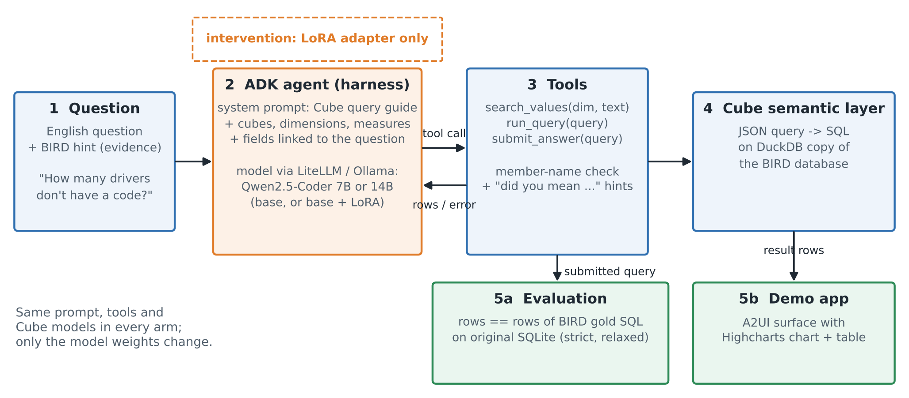
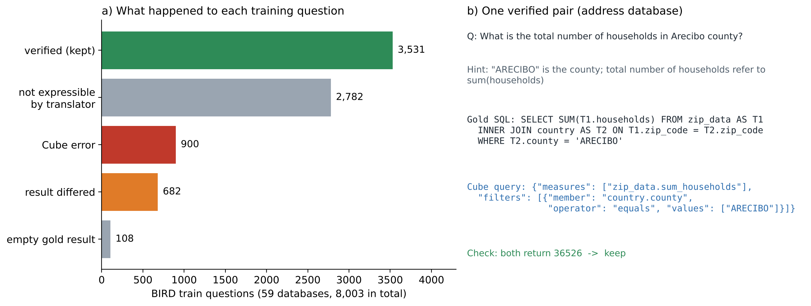
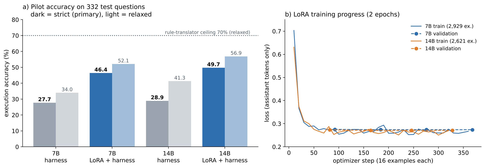

# Project proposal: Asking a database in plain English through a semantic layer

**Does LoRA fine-tuning beat a well-engineered prompt-and-tools harness for text-to-Cube query generation?**

MSc Generative AI module · Shamir · code: [github.com/shamx9ir/msc-ce893](https://github.com/shamx9ir/msc-ce893)

Files in this folder: this proposal (also as [`proposal.pdf`](proposal.pdf)), [`data_sample/`](data_sample) (8 training pairs, 6 test questions),
[`figures/`](figures) and [`make_figures.py`](make_figures.py), which redraws every figure from
[`pilot_results.json`](pilot_results.json).

---

## 1. Title and task

**Task: text-to-Cube.** An analyst who knows the business but not SQL types a question in **English**.
A local LLM agent turns it into a **Cube semantic-layer query** (a short JSON object naming measures,
dimensions, filters and ordering), Cube runs it, and the answer is shown as a **table and a Highcharts
chart** on an A2UI surface. Generating Cube queries instead of raw SQL keeps joins and aggregations in a
reviewed model, so the LLM only has to choose names and filters.

- **Intended user:** non-technical analyst exploring a relational database.
- **Input:** an English question plus BIRD's one-line hint ("evidence"), and the database's Cube schema.
- **Output:** a Cube JSON query, its result rows, and a chart.

| Question (database) | Expected Cube query |
|---|---|
| How many drivers don't have a code? *(formula_1)* | `{"measures": ["drivers.count"], "filters": [{"member": "drivers.code", "operator": "notSet"}]}` |
| What's Angela Sanders's major? *(student_club)* | `{"dimensions": ["major.major_name"], "filters": [{"member": "member.first_name", "operator": "equals", "values": ["Angela"]}, {"member": "member.last_name", "operator": "equals", "values": ["Sanders"]}]}` |
| Which year was the first Singapore Grand Prix? *(formula_1)* | `{"dimensions": ["races.year"], "filters": [{"member": "circuits.country", "operator": "equals", "values": ["Singapore"]}], "order": {"races.year": "asc"}, "limit": 1}` |

**Figure 1. From question to answer.** The question goes to an agent built with Google's Agent
Development Kit (ADK). It can look up stored values, try a draft query and submit a final one; Cube
translates the JSON into SQL on a DuckDB copy of the database. Notice that the prompt, tools and Cube
models are identical in every condition: only the model weights change.

## 2. Research question

> For the same base model and the same harness, does adding a LoRA adapter trained on verified
> text-to-Cube examples raise **strict execution accuracy** on unseen BIRD databases?

- **Intervention:** a LoRA adapter (rank 16) on Qwen2.5-Coder-Instruct, trained on BIRD *train* questions
  converted to Cube queries. Everything else (prompt, tools, Cube models, decoding) is held fixed.
- **Outcome:** strict execution accuracy, the share of test questions whose Cube result has the same
  rows and columns as BIRD's gold SQL result. Secondary: relaxed accuracy (extra columns allowed),
  agent steps and latency per question.
- **Secondary question:** does the gain hold at two model sizes (7B and 14B)?

## 3. Chosen route: prompt engineering + tools as the baseline, LoRA fine-tuning as the intervention

- **Prompt engineering and tools** come first because the agent must follow a strict JSON grammar and
  call tools; a good harness (schema listing, value search, name checks with "did you mean" hints) is
  the fair, cheap baseline every application would start with.
- **RAG is not the right fit as the main method.** The knowledge the model needs (the schema) is small
  and already fits in the prompt; the harness already retrieves the relevant fields and stored values.
  The difficulty is *skill*: using measures vs dimensions, Cube filter operators, joins implied by names.
- **Fine-tuning suits a skill gap.** Small local models misuse the Cube grammar in systematic ways
  (in an early run the most common error was putting a dimension in `measures`). LoRA through
  Hugging Face PEFT teaches this format cheaply: about 0.5% of the weights train, and 4-bit QLoRA fits
  a 7B or 14B model on one 16 GB GPU.

## 4. Data

| | |
|---|---|
| **Source** | BIRD text-to-SQL benchmark, <https://bird-bench.github.io/> (train: `train.zip`, dev: `dev.zip`). Li et al., *Can LLM Already Serve as a Database Interface?*, NeurIPS 2023. |
| **Usage conditions** | CC BY-SA 4.0 (licence changed to this on 27 April 2024, per the BIRD site). Research use with attribution; derived data shared under the same licence. |
| **Test set** | All **332** dev questions on `formula_1` (174) and `student_club` (158), frozen in `splits/test_ids.json`. |
| **Tuning set** | 363 dev questions on three other databases (superhero, toxicology, california_schools), used for harness changes only. |
| **Training pool** | BIRD train: ~9,400 questions on 69 databases, none shared with the test databases. |

**Cleaning and preparation** (Figure 2, `scripts/build_training_data.py`, `harness/sql2cube.py`):

1. Copy each SQLite database into DuckDB and generate Cube models from BIRD's schema and column
   descriptions (`scripts/gen_cube_models.py`).
2. Translate each gold SQL query into a Cube query with a rule-based translator; drop SQL a semantic layer
   cannot express (subqueries, CASE arithmetic, string slicing).
3. **Verify every pair by execution:** run the Cube query and the gold SQL and keep the pair only if the
   results match. Drop pairs with an empty gold result, since they verify nothing.
4. Add `search_values` tool steps where a filter uses a stored text value, so the examples show the
   look-up behaviour (`scripts/add_value_searches.py`).
5. Write chat-format examples that reproduce the harness's exact prompt and tool calls
   (`scripts/make_sft.py`); hold out 3 whole databases for validation.

Result: **3,531 verified pairs** from 59 databases (3,273 train / 258 validation). Samples:
[`data_sample/train_sample.jsonl`](data_sample/train_sample.jsonl) and
[`data_sample/test_sample.jsonl`](data_sample/test_sample.jsonl).

**Reference-answer verification.** The test reference is the *result* of BIRD's gold SQL on the original
SQLite file, not a reference Cube query, so any correct query is accepted. The same translator
reproduces only 70% of the test answers, which gives a realistic ceiling for this task.

**Figure 2. Building the training set.** (a) Only 44% of the train questions survive translation and
execution checks; the grey bars are SQL that Cube cannot express. (b) A kept pair: the gold SQL and the
Cube query return the same value, so the pair is known to be correct.

## 5. Practical plan

- **Model.** The pipeline works with any instruction-tuned Hugging Face model that has a tool-calling
  chat template. If the instructor's model differs from Qwen2.5-Coder-7B-Instruct, it replaces the
  `--base` argument of `scripts/train_lora.py` and the Ollama tag in the evaluator; the data and harness
  are unchanged. Qwen2.5-Coder 7B and 14B serve as the pilot models: the Coder variants were chosen
  because the task is mostly strict JSON with exact field names, which matches their code and SQL training;
  both support tool calls and run in Ollama, and at 7B and 14B both sizes can be QLoRA-trained on a 16 GB GPU.
- **Training.** QLoRA with Hugging Face PEFT: 4-bit base, rank 16, alpha 32, learning rate 2e-4,
  2 epochs, effective batch 16, loss on assistant tokens only, examples up to 8,192 tokens (4,096 for 14B).
- **Compute.** Training runs on a local RTX 5070 Ti (16 GB), about 5–7 hours for the 7B model. The Colab
  free tier allows at most 12 hours per session with no guaranteed GPU, so Colab is the fallback, using
  shorter examples and `--resume` from checkpoints.
- **Serving.** `scripts/export_ollama.py` merges the adapter, converts to GGUF and quantises to Q4_K_M,
  the same quantisation as the base model in Ollama, so the arms differ only by the adapter.
- **Extra tools.** Cube (semantic layer) on DuckDB, ADK + LiteLLM for the agent, Ollama for serving,
  A2UI + Highcharts for the demo app, and a runnable notebook that reproduces data preparation,
  evaluation and figures from the saved run files.

## 6. Evaluation

| Condition | Model | Harness | Purpose |
|---|---|---|---|
| A | Qwen2.5-Coder-7B | v4.2 prompt + 3 tools | baseline |
| B | Qwen2.5-Coder-7B + LoRA | same | intervention |
| C | Qwen2.5-Coder-14B | same | larger baseline |
| D | Qwen2.5-Coder-14B + LoRA | same | intervention at scale |

- **Splits.** Train on BIRD train (59 databases); validate on 3 held-out train databases; tune the harness on
  3 dev databases; report once on the frozen 332-question test set on 2 further databases. No database
  appears in more than one split.
- **Primary metric.** Strict execution accuracy. Paired comparison per question with McNemar's exact
  test (A vs B, C vs D, B vs D). Secondary: relaxed accuracy, accuracy by database and BIRD difficulty,
  steps and latency.
- **Error analysis.** Classify every wrong answer from the run traces: wrong member chosen, dimension
  used as measure, wrong filter value (value not looked up), wrong operator, missing or extra column,
  Cube error, and question outside the semantic layer. Compare the counts before and after LoRA and
  show real successful and failed outputs.

**Pilot.** A first pass of all four conditions already ran (Figure 3). LoRA raised strict accuracy from
27.7% to 46.4% (7B, McNemar p < 1e-10) and from 28.9% to 49.7% (14B, p < 1e-14); 7B vs 14B with LoRA was
not significant (p = 0.12). The pilot also exposed a weakness to analyse: the LoRA models almost never
call `search_values`, so filters on stored values such as lap times (`'0:01:54'` vs stored `'1:54.xxx'`)
fail.

**Figure 3. Pilot results.** (a) Both LoRA models clearly beat their harness-only baselines and approach
the 70% translator ceiling more closely. (b) Training loss falls within the first 50 steps and validation
loss stays flat after half an epoch, so one epoch may be enough.

## 7. Work plan

| Stage | Output | Status |
|---|---|---|
| 1. Data: BIRD → DuckDB → Cube models; frozen splits | `scripts/`, `cube/model/`, `splits/` | done |
| 2. Harness: ADK agent, 3 tools, evaluator; tune on dev DBs | `harness/` (v4.2 frozen) | done |
| 3. Training data: translate, verify, add value searches | `training_data/` (3,531 pairs) | done |
| 4. LoRA training and export, 7B then 14B | `train_lora.py`, `export_ollama.py` | pilot done |
| 5. Final evaluation, significance tests, error analysis | `runs/*.jsonl`, notebook | next |
| 6. Demo app: Cube + A2UI + Highcharts, model picker | `app/` | in review |
| 7. Report with figures and runnable notebook | report | last |

This is an individual project; I am responsible for every stage.

**Likely obstacles.** (1) Memory: 14B training only fits with examples up to 4,096 tokens, and merging
needs ~32 GB RAM. (2) Disk space for merged and quantised models. (3) The 14B LoRA model sometimes emits
tool calls as text, which the harness has to parse. (4) 30% of test questions are outside what the semantic
layer can express, which caps all conditions. (5) Run-to-run variance in a 332-question test set.

**Planned extension.** Run a newer general Qwen model of similar size (8–14B) as a harness-only baseline on
the 363 tuning questions, to check whether the choice of base model matters; if it clearly wins, discuss it
in the report as future work rather than replacing the four main conditions.

**Smaller feasible scope.** If time or compute runs short: 7B only (conditions A and B), one test database
(student_club, 158 questions), one training epoch, and a single significance test. This still answers the
research question.
