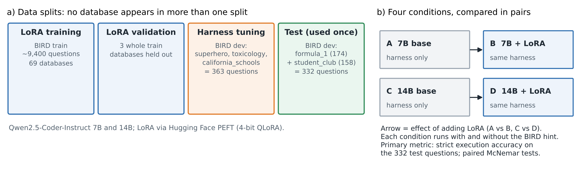

# Project proposal: Asking a database in plain English through a semantic layer

**Does LoRA fine-tuning beat a well-engineered prompt-and-tools harness for text-to-Cube query generation?**

MSc Generative AI module · Shamir · code: [github.com/shamx9ir/msc-ce893](https://github.com/shamx9ir/msc-ce893)

Files in this folder: this proposal (also as [`proposal.pdf`](proposal.pdf)), [`data_sample/`](data_sample)
(8 example training pairs, 6 test questions), [`figures/`](figures) and [`make_figures.py`](make_figures.py),
which redraws every figure.

---

## 1. Title and task

**Task: text-to-Cube.** An analyst who knows the business but not SQL types a question in **English**.
A local LLM agent turns it into a **Cube semantic-layer query** (a short JSON object naming measures,
dimensions, filters and ordering), Cube runs it, and the answer is shown as a **table and a Highcharts
chart** on an A2UI surface. Generating Cube queries instead of raw SQL keeps joins and aggregations in a
reviewed model, so the LLM only has to choose names and filters.

- **Intended user:** non-technical analyst exploring a relational database.
- **Input:** an English question and the database's Cube schema, tested both with and without BIRD's
  one-line hint ("evidence"), since a real analyst would not normally write one.
- **Output:** a Cube JSON query, its result rows, and a chart.

| Question (database) | Expected Cube query |
|---|---|
| How many drivers don't have a code? *(formula_1)* | `{"measures": ["drivers.count"], "filters": [{"member": "drivers.code", "operator": "notSet"}]}` |
| What's Angela Sanders's major? *(student_club)* | `{"dimensions": ["major.major_name"], "filters": [{"member": "member.first_name", "operator": "equals", "values": ["Angela"]}, {"member": "member.last_name", "operator": "equals", "values": ["Sanders"]}]}` |
| Which year was the first Singapore Grand Prix? *(formula_1)* | `{"dimensions": ["races.year"], "filters": [{"member": "circuits.country", "operator": "equals", "values": ["Singapore"]}], "order": {"races.year": "asc"}, "limit": 1}` |

**Figure 1. Planned pipeline from question to answer.** The question goes to an agent built with Google's
Agent Development Kit (ADK). It can look up stored values, try a draft query and submit a final one; Cube
translates the JSON into SQL on a DuckDB copy of the database. Notice that the prompt, tools and Cube
models will be identical in every condition: only the model weights change.

## 2. Research question

> For the same base model and the same harness, does adding a LoRA adapter trained on verified
> text-to-Cube examples raise **strict execution accuracy** on unseen BIRD databases?

- **Intervention:** a LoRA adapter on Qwen2.5-Coder-Instruct, trained on BIRD *train* questions converted
  to Cube queries. Everything else (prompt, tools, Cube models, decoding) is held fixed.
- **Outcome:** strict execution accuracy, the share of test questions whose Cube result has the same
  rows and columns as BIRD's gold SQL result. Secondary: relaxed accuracy (extra columns allowed),
  agent steps and latency per question.
- **Hypothesis:** LoRA improves strict accuracy at both 7B and 14B, mainly by reducing format errors
  (wrong member type, invalid filter operators) rather than by adding knowledge.
- **Second question:** how much does each setup depend on the hint? I expect all conditions to drop
  without it, and the LoRA models (trained with hints) possibly to drop more.

## 3. Chosen route: prompt engineering + tools as the baseline, LoRA fine-tuning as the intervention

- **Prompt engineering and tools** come first because the agent must follow a strict JSON grammar and
  call tools. A careful harness (schema listing, value search, name checks with "did you mean" hints) is
  the fair, cheap baseline any application would start with.
- **RAG is not the right fit as the main method.** The knowledge the model needs (the schema) is small
  enough to fit in the prompt, and the value-search tool already retrieves stored values on demand.
  The expected difficulty is *skill*: choosing measures vs dimensions, using Cube's filter operators,
  and following the JSON format reliably.
- **Fine-tuning suits a skill gap.** Small local models are unlikely to have seen Cube's query format, so
  examples should teach it more reliably than instructions alone. LoRA through Hugging Face PEFT trains
  under 1% of the weights, and 4-bit QLoRA should fit a 7B or 14B model on one 16 GB GPU.

## 4. Data

| | |
|---|---|
| **Source** | BIRD text-to-SQL benchmark, <https://bird-bench.github.io/> (train: `train.zip`, dev: `dev.zip`). Li et al., *Can LLM Already Serve as a Database Interface?*, NeurIPS 2023. |
| **Usage conditions** | CC BY-SA 4.0 (licence changed to this on 27 April 2024, per the BIRD site). Research use with attribution; derived data shared under the same licence. |
| **Test set** | All **332** dev questions on `formula_1` (174) and `student_club` (158). |
| **Tuning set** | 363 dev questions on three other databases (superhero, toxicology, california_schools), for harness design only. |
| **Training pool** | BIRD train: about 9,400 questions on 69 databases, none shared with the test databases. Some of the largest databases may be skipped for disk and time reasons. |

**Planned cleaning and preparation** (Figure 2):

1. Copy each SQLite database into DuckDB and generate Cube models from BIRD's schema and column
   descriptions.
2. Translate each gold SQL query into a Cube query with a rule-based translator. Drop SQL that a semantic
   layer cannot express (subqueries, CASE arithmetic, string slicing). I expect a large share to be dropped
   here, so the final set will be smaller than the pool, likely a few thousand pairs.
3. **Verify every pair by execution:** run the Cube query and the gold SQL and keep the pair only if the
   results match. Drop pairs with an empty gold result, since they verify nothing.
4. Add value-search tool steps where a filter uses a stored text value, so examples show the look-up step.
5. Write chat-format examples that reproduce the harness's exact prompt and tool calls; hold out 3 whole
   databases for validation.

Examples of the target format: [`data_sample/train_sample.jsonl`](data_sample/train_sample.jsonl) (question,
hint, gold SQL, Cube query) and [`data_sample/test_sample.jsonl`](data_sample/test_sample.jsonl).

**Reference-answer verification.** The test reference is the *result* of BIRD's gold SQL on the original
SQLite file, not a reference Cube query, so any correct query is accepted. Running the translator on the
test questions will also show how many are expressible in Cube at all, which gives a ceiling for every
condition.

**Figure 2. Building the training set.** (a) The five planned preparation steps; step 4 is what makes every
training pair trustworthy. (b) A prepared pair: the gold SQL and the Cube query must return the same value
before the pair is kept.

## 5. Practical plan

- **Model.** The pipeline will work with any instruction-tuned Hugging Face model that has a tool-calling
  chat template, so the instructor's model only replaces the base-model setting; data and harness stay
  the same. Until then I plan on Qwen2.5-Coder-7B-Instruct and 14B-Instruct (both public on Hugging Face
  and Ollama). The Coder variants suit a task that is mostly strict JSON with exact field names, both support
  tool calls, and both sizes can be QLoRA-trained on a 16 GB GPU.
- **Training.** QLoRA with Hugging Face PEFT: 4-bit base, rank 16, alpha 32, learning rate 2e-4, about
  2 epochs, loss on the assistant's turns only. The 14B model will probably need shorter examples to fit.
- **Compute.** Local RTX 5070 Ti (16 GB); I estimate several hours per training run. The Colab free tier
  allows at most 12 hours per session with no guaranteed GPU, so it is the fallback, with checkpoints so
  a run can resume.
- **Serving.** Merge the adapter, convert to GGUF and quantise to the same 4-bit format as the base model
  in Ollama, so the conditions differ only by the adapter.
- **Extra tools.** Cube on DuckDB (semantic layer), ADK + LiteLLM (agent), Ollama (serving), A2UI +
  Highcharts (demo app), and a runnable notebook that reproduces data preparation, evaluation and figures.

## 6. Evaluation

**Figure 3. Evaluation design.** (a) Four disjoint splits; the test set is used once, at the end.
(b) Each base model is compared with itself plus LoRA, so any difference comes from the adapter; all four
are run with and without the hint.

- **Baselines and conditions.** A: 7B base + harness; B: 7B + LoRA + harness; C: 14B base + harness;
  D: 14B + LoRA + harness. Each is run twice on the test set: **with the hint** (BIRD's standard setting,
  comparable with published work) and **without the hint** (question only, closer to real use), giving
  8 runs. Training data keeps the hint. A single-shot prompt without tools is an optional extra baseline.
- **Splits.** Train on BIRD train, validate on 3 held-out train databases, design the harness on the
  3 tuning databases, then freeze it and report once on the 332 test questions.
- **Primary metric.** Strict execution accuracy, with paired McNemar tests per question (A vs B, C vs D,
  B vs D, each with and without the hint, and each condition with vs without the hint). Secondary: relaxed accuracy, accuracy by database and BIRD difficulty, steps and latency.
- **Error analysis.** Classify every wrong answer from the saved traces: wrong member, dimension used as a
  measure, wrong filter value, wrong operator, missing or extra column, Cube error, and question outside the
  semantic layer. Compare the counts before and after LoRA and show real successful and failed outputs.

## 7. Work plan

| Weeks | Stage | Output |
|---|---|---|
| 1 | Data: BIRD → DuckDB → Cube models; fix the splits | Cube models, split files |
| 2 | Harness: ADK agent, 3 tools, evaluator; design on tuning databases | harness, baselines A and C |
| 3 | Training data: translate, verify, add value searches, format | verified training set |
| 4–5 | LoRA training and export, 7B then 14B | adapters, conditions B and D |
| 6 | Test-set evaluation (8 runs: 4 conditions × hint / no hint), significance tests, error analysis | run files, notebook |
| 7 | Demo app (Cube + A2UI + Highcharts) and report | app, report |

This is an individual project; I am responsible for every stage.

**Likely obstacles.** (1) GPU memory: the 14B model may only train with shorter examples. (2) Disk space
and RAM for merging and quantising the 14B model. (3) The base models may write tool calls as plain text,
which the harness must parse. (4) Some test questions will not be expressible in Cube, which caps all
conditions. (5) Run-to-run variance on a 332-question test set.

**Planned extension.** Run a newer general Qwen model of similar size (8–14B) as a harness-only baseline on
the tuning questions, to check whether the choice of base model matters.

**Smaller feasible scope.** If time or compute runs short: 7B only (conditions A and B, with and without the hint), one test database
(student_club, 158 questions), one training epoch and a single significance test. This still answers the
research question.
